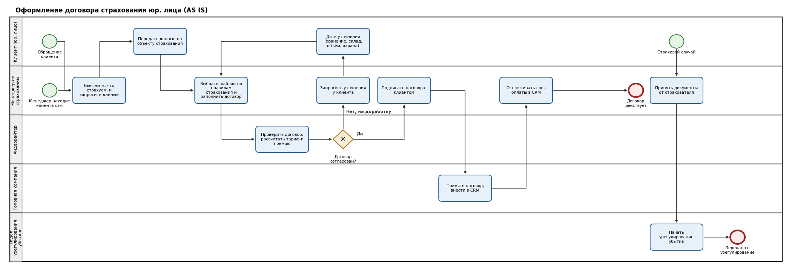

# Кейс: оформление договора страхования юридического лица (AS IS → TO BE)

Учебный кейс бизнес-аналитика на основе моего реального опыта работы в страховых компаниях (ВСК, «Транснефть»). Данные клиентов и внутренние регламенты не используются, процесс описан обобщённо.

**Что в кейсе:** процесс AS IS в BPMN, роли и правила, статусная модель договора, проблемы и метрики, предложения TO BE, user stories с критериями приёмки, модель данных, нефункциональные требования.

**Файлы:** `process_as_is.bpmn` (открывается в [bpmn.io](https://demo.bpmn.io) и Camunda Modeler), `process_as_is.png` (превью диаграммы).

---

## 1. Контекст и цель

Менеджер по страхованию юридических лиц оформляет договоры страхования (автопарк, товарно-материальные ценности, ответственность при строительстве, участие в СРО). Договор проходит согласование у андеррайтера, подписывается клиентом, регистрируется в головной компании и контролируется по оплате. При страховом случае менеджер принимает документы и передаёт их в урегулирование убытков.

**Цель кейса:** описать текущий процесс, найти узкие места, сформулировать проверяемые гипотезы и требования к улучшению.

## 2. Участники

| Роль | Что делает в процессе |
|---|---|
| Клиент (юр. лицо) | Директор или заместитель; предоставляет данные об объекте страхования, подписывает договор, оплачивает |
| Менеджер по страхованию | Ведёт клиента, готовит договор по шаблону, собирает данные, передаёт на согласование, подписывает, отслеживает оплату, принимает документы по страховому случаю |
| Андеррайтер | Проверяет договор, рассчитывает тариф и страховую премию, согласовывает или возвращает на доработку |
| Головная компания (Москва) | Принимает подписанный договор, вносит его в CRM |
| Отдел урегулирования убытков | Принимает документы по страховому случаю и ведёт урегулирование |

## 3. Процесс AS IS

**Старт процесса:** обращение клиента или самостоятельный поиск клиента менеджером.

| № | Роль | Действие | Результат |
|---|---|---|---|
| 1 | Менеджер | Выясняет, что страхуем, и какие данные нужны для этого вида страхования | Перечень данных, которые нужно запросить |
| 2 | Клиент | Передаёт данные по объекту страхования | Данные у менеджера |
| 3 | Менеджер | Выбирает шаблон договора под правила страхования, заполняет его | Договор подготовлен |
| 4 | Андеррайтер | Проверяет договор, рассчитывает тариф и премию | Решение: согласован или на доработку |
| 5 | Менеджер, Клиент | Если на доработку: менеджер запрашивает уточнения, клиент их даёт; возврат на шаг 3 | Договор исправлен и вновь отправлен |
| 6 | Менеджер | После согласования подписывает договор с клиентом | Договор подписан |
| 7 | Головная компания | Принимает подписанный договор, вносит в CRM | Договор в CRM |
| 8 | Менеджер | Отслеживает срок оплаты в CRM | Договор действует |

**Подпроцесс «Страховой случай»:** клиент сообщает о случае, менеджер принимает документы от страхователя и передаёт их в отдел урегулирования убытков.

## 4. Правила и исключения

- **Набор данных зависит от вида страхования.** Например, для автопарка нужны данные по транспортным средствам, для ТМЦ: как хранятся ценности, склад, материал здания, объём, наличие охраны.
- **Основное исключение: возврат на доработку.** Андеррайтер возвращает договор, если нужно изменить тариф или не хватает данных о риске. Это самый частый сценарий (по моему опыту).
- Менеджер отвечает за полноту данных клиента в CRM.

## 5. Статусная модель договора (предлагаемая)

| Статус | Когда наступает | Следующие статусы |
|---|---|---|
| Черновик | Менеджер создал договор по шаблону | На согласовании |
| На согласовании | Отправлен андеррайтеру | Согласован, На доработке |
| На доработке | Андеррайтер вернул с причиной | На согласовании |
| Согласован | Андеррайтер одобрил тариф и премию | Подписан клиентом |
| Подписан клиентом | Договор подписан обеими сторонами | Зарегистрирован |
| Зарегистрирован | Головная компания внесла договор в CRM | Действует |
| Действует | Договор вступил в силу, контролируется оплата | Закрыт, Пролонгирован |

## 6. Проблемы (гипотезы) и метрики

Гипотезы сформулированы по опыту, цифр по реальным договорам нет. В реальном проекте их нужно проверять по данным CRM.

| Гипотеза | Как проверить | Метрика |
|---|---|---|
| Договоры часто возвращаются из-за недостающих данных клиента, потому что перечень данных не зафиксирован по видам страхования | Выгрузить из CRM число возвратов и их причины | Доля договоров с возвратом; среднее число итераций согласования |
| Причины возврата не структурированы, и менеджер не понимает, что уточнять | Проанализировать комментарии андеррайтеров | Распределение причин возврата |
| Контроль сроков оплаты ведётся вручную, часть просрочек замечается поздно | Сравнить дату оплаты и срок по договорам | Доля договоров с просрочкой оплаты; дни просрочки |

## 7. TO BE: предлагаемые изменения

1. **Чек-лист данных по видам страхования.** При выборе вида страхования менеджер видит перечень обязательных данных и запрашивает их у клиента сразу.
2. **Справочник причин возврата.** Андеррайтер выбирает причину из списка и может добавить комментарий.
3. **Единый статус договора и напоминания об оплате.** Система показывает статус и напоминает менеджеру о приближающемся сроке оплаты.
4. **Регистрация страхового случая с документами** и передачей в урегулирование из одной карточки.

## 8. Требования: user stories

### US-1. Чек-лист данных
**Как** менеджер, **я хочу** видеть перечень обязательных данных для выбранного вида страхования, **чтобы** запросить всё у клиента сразу и сократить возвраты.

Критерии приёмки:
- **Дано** выбран вид страхования, **когда** открывается карточка договора, **тогда** отображается список обязательных данных для этого вида.
- **Дано** не все обязательные данные заполнены, **когда** менеджер отправляет договор на согласование, **тогда** система показывает, чего не хватает, и не отправляет.

### US-2. Отправка на согласование
**Как** менеджер, **я хочу** отправить заполненный договор андеррайтеру из карточки, **чтобы** не пересылать файлы вручную.

Критерии приёмки:
- **Дано** договор заполнен, **когда** менеджер нажимает «На согласование», **тогда** статус меняется на «На согласовании», андеррайтер получает уведомление.
- Менеджер не может редактировать договор, пока он на согласовании.

### US-3. Возврат на доработку с причиной
**Как** андеррайтер, **я хочу** вернуть договор на доработку с причиной из списка и комментарием, **чтобы** менеджер понял, что уточнить у клиента.

Критерии приёмки:
- Без выбора причины вернуть договор нельзя.
- После возврата статус «На доработке», менеджер получает уведомление с причиной и комментарием.
- История возвратов сохраняется в карточке договора.

### US-4. Контроль оплаты
**Как** менеджер, **я хочу** видеть срок оплаты и получать напоминание за N дней до него, **чтобы** вовремя связаться с клиентом.

Критерии приёмки:
- **Дано** договор в статусе «Действует» с заданным сроком оплаты, **когда** до срока остаётся N дней, **тогда** менеджер получает напоминание.
- Просроченные договоры подсвечены и отсортированы по числу дней просрочки.

### US-5. Страховой случай
**Как** менеджер, **я хочу** зарегистрировать страховой случай, приложить документы страхователя и передать в урегулирование, **чтобы** клиент получил обработку обращения без потери документов.

Критерии приёмки:
- Случай привязан к действующему договору.
- Передача в отдел урегулирования доступна, только если приложены обязательные документы.
- После передачи менеджер видит статус рассмотрения.

## 9. Модель данных (сущности и атрибуты)

| Сущность | Основные атрибуты |
|---|---|
| Клиент (юр. лицо) | наименование, ИНН, адрес, контактное лицо, должность |
| Вид страхования | код, название, перечень обязательных данных |
| Шаблон договора | код, вид страхования, версия |
| Договор | номер, клиент, вид страхования, шаблон, статус, тариф, премия, срок оплаты, дата подписания |
| Согласование | договор, андеррайтер, дата, решение, причина возврата, комментарий |
| Платёж | договор, сумма, срок, дата оплаты, статус |
| Страховой случай | договор, дата, описание, статус |
| Документ | тип, файл, привязка к договору или случаю |

Связи: у клиента много договоров; у договора много согласований и платежей; у договора много страховых случаев; у случая много документов.

## 10. Нефункциональные требования

- **Персональные данные:** хранение и обработка в соответствии с 152-ФЗ.
- **Доступы:** менеджер видит только свои договоры; андеррайтер видит договоры на согласовании; доступ к страховым случаям ограничен отделом урегулирования.
- **Аудит:** фиксируются все изменения статусов с датой и автором.
- **Уведомления:** доставка не позднее чем через 5 минут после события.

## 11. Открытые вопросы

- Как обрабатывается просрочка оплаты по договору и кто за неё отвечает?
- Какие системы участвуют (CRM, учётная система), и как договор попадает из CRM в бухгалтерский учёт?
- Какие шаблоны и правила страхования используются для каждого вида?

## 12. Глоссарий

- **Андеррайтер:** специалист, оценивающий риск и определяющий условия и стоимость страхования.
- **Тариф:** ставка страховой премии.
- **Страховая премия:** сумма, которую страхователь платит за страхование.
- **Страхователь:** клиент, заключивший договор страхования.
- **Урегулирование убытков:** рассмотрение страхового случая и выплата возмещения.
- **СРО:** саморегулируемая организация, участие в которой может требовать страхования ответственности.
